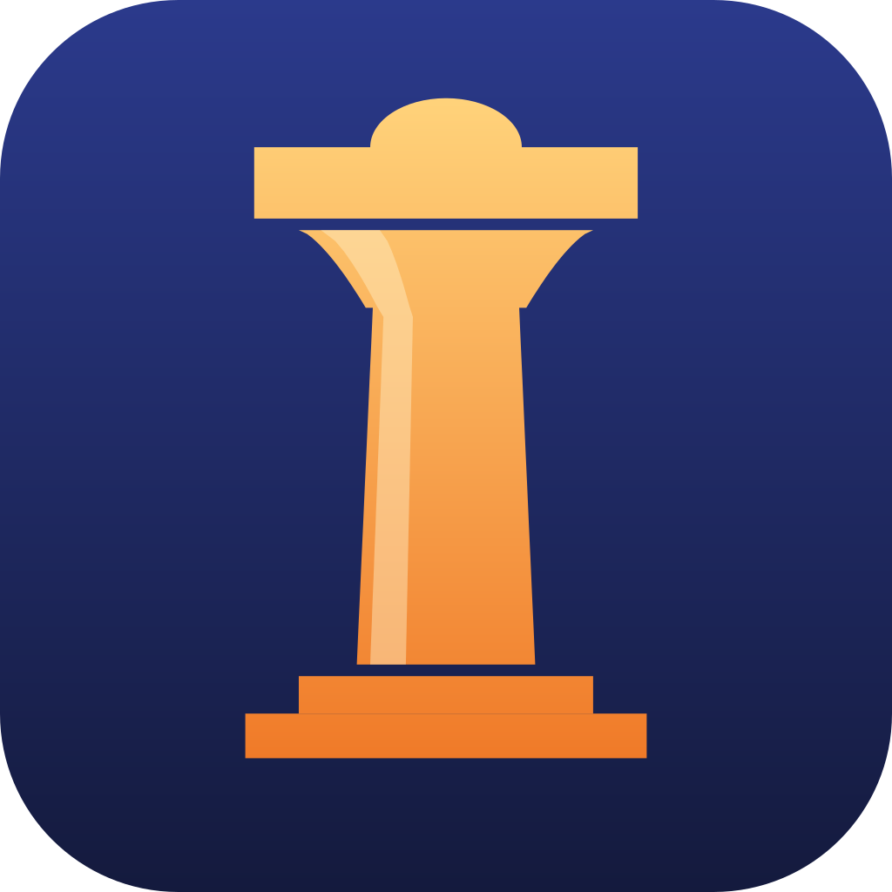
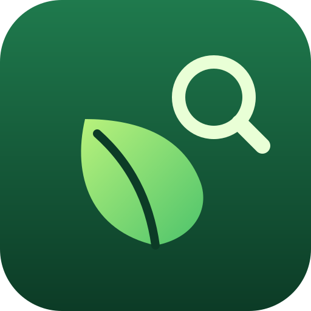
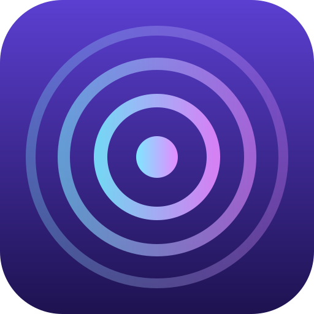

### Hi, I'm Garvit 👋

I build systems software and on-device AI. Class XII (ISC) at Sanskriti The Gurukul, Guwahati, India. I've been taking computers apart in software since 2020, when I got macOS running on my i3-6006U laptop with OpenCore.

 

**[Stambha](https://github.com/garvitsurana271/stambha)**: run the real Apple-silicon macOS on ordinary PCs, straight from a USB stick. I lead it as the continuation of Stela after its creator archived the project: a bare-metal Rust UEFI program with an AArch64-to-x86 translator, a Metal driver for NVIDIA GPUs and a model of Apple's hardware.

- Ported Linux's `rtw89` Wi-Fi driver to Rust for the Realtek RTL8852CE, so macOS installs over Wi-Fi. Brought up on my own laptop, from firmware boot to WPA2/3 and HTTPS.
- Apple's matrix engine (AMX) running natively on the PC's CPU: up to 375× faster per operation, bit-exact against the reference model.
- Laptop support (battery, touchpad gestures, brightness, lid) and experimental AMD and Intel graphics. [Website](https://garvitsurana271.github.io/stambha/) · a Discord of testers

  

**[Burnd](https://github.com/garvitsurana271/burnd)**: find what's burning a hole in your AI coding budget. A local-first CLI that reads Claude Code session logs and ranks nine cost-leak patterns by dollar value.

- 1,305 npm installs in its first 48 hours, listed in five community awesome-lists. `npx getburnd`

  

**[Viveka](https://github.com/garvitsurana271/viveka)**: check a suspicious chat forward before you spread it. Breaks a message into claims, searches trusted sources in a multi-hop loop, and returns a calibrated verdict with citations, or hands it to a human when the evidence is thin.

- Benchmarked on AVeriTeC, with the caveats published, not just the flattering numbers. USAII Global AI Hackathon 2026.

  

**KropScan**: offline-first crop disease detection for farmers with poor connectivity. Three-tier inference: ONNX on the device, Gemma in the cloud, graceful fallback between them.

- 3rd of 200+ teams at the Masters' Union AI Hackathon 2026, India's largest high-school AI hackathon.

  

**[Pravaah](https://github.com/garvitsurana271/pravaah)**: an explainable train-dispatch copilot for Indian Railways section controllers, with an interlocking layer that makes unsafe states unrepresentable.

- Built for FAR AWAY 2026. [Live demo](https://garvitsurana271.github.io/pravaah/)

  

**AuraSound**: turns a laptop, a TV, a Bluetooth speaker and any number of phones into one calibrated surround system.

- Per-device EQ, channel routing, and tactile bass through phone vibration motors for frequencies small speakers can't reproduce.

 

---

**Recognition**
- Masters' Union AI Hackathon 2026: 3rd of 200+ teams
- IIT Kharagpur Young Innovators Program: Top 5 of 1,500 (international)
- IIT Guwahati Research and Industrial Conclave: 1st place
- The Big Plan 2.0, SRCC, Delhi University: Finalist
- National Math-n-Coding 2024: Winner · LogIQids: International rank 34
- ICSE 2025: Certificate of Excellence (CISCE)

**Stack:** Rust (bare-metal, UEFI, drivers) · TypeScript · React · Node · Python · FastAPI · ONNX Runtime · Three.js · Claude API

[Portfolio](https://garvit-surana.vercel.app) · [Stambha](https://garvitsurana271.github.io/stambha/) · [npm](https://www.npmjs.com/~garvitsurana271) · garvitsurana10@gmail.com
